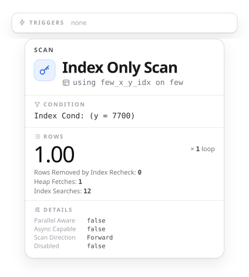
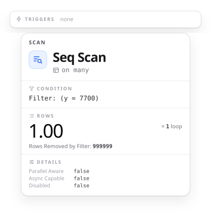

:properties:
:ID: 20261012T010120
:end:
#+title:      KDOC 657: PostgreSQL 18のスキップスキャンを試す
#+date:       [2026-10-12 Mon 01:01]
#+filetags:   :permanent:
#+identifier: 20261012T010120

* この文書のステータス
- 作成
  - [X] 2026-10-13 貴島
- レビュー
  - [X] 2026-10-13 貴島

* 概要
:PROPERTIES:
  :header-args+: :engine postgresql
  :header-args+: :dbhost localhost
  :header-args+: :dbport 15431
  :header-args+: :results verbatim raw
  :header-args+: :wrap no
  :header-args+: :colnames no
  :header-args+: :cmdline -q
:END:

PostgreSQL 18 から、複数列の B-tree インデックスで、先頭の列に条件がないとき、先頭の列の値ごとにインデックスを探し直して、関係のない部分を読み飛ばせるようになった(スキップスキャン)。

#+begin_quote
たとえば、(x, y)に対するインデックスと問い合わせ条件WHERE y = 7700では、B-treeインデックススキャンでスキップスキャン最適化を適用できる場合があります。 これは通常、問い合わせプランナがそのテーブルで使用可能なインデックスを考慮した時に、WHERE x = N AND y = 7700の検索を、Nで取り得るすべての値（または実際にインデックスに格納されているすべてのxの値）に対して繰り返す方法が最速であると想定している場合に発生します。 この方法は通常、xの個別値が非常に少なく、ほとんどのインデックスをスキップしてスキャンする（ほとんどのリーフページには関連するタプルが含まれないため）とプランナが期待する場合にのみ採用されます。

[[https://www.postgresql.jp/docs/18/indexes-multicolumn.html][11.3. 複数列インデックス]]
#+end_quote

同じ (x, y) のインデックスで、x の種類が 10 のテーブルと 10 万のテーブルを作り、WHERE y = 7700 の実行計画を比べる。

#+caption: 先頭の列の種類の数を変えて、WHERE y = 7700 の実行計画を比べる
#+begin_src sql
  -- 出力を短くするため、並列実行を切る
  SET max_parallel_workers_per_gather = 0;

  CREATE TABLE few (x int, y int);
  CREATE TABLE many (x int, y int);
  INSERT INTO few
  SELECT i % 10, i FROM generate_series(1, 1000000) i;
  INSERT INTO many
  SELECT i % 100000, i FROM generate_series(1, 1000000) i;
  CREATE INDEX ON few (x, y);
  CREATE INDEX ON many (x, y);
  ANALYZE few;
  ANALYZE many;

  -- x が 10 種類
  EXPLAIN (ANALYZE, FORMAT JSON, COSTS OFF, TIMING OFF,
           SUMMARY OFF, BUFFERS OFF)
  SELECT * FROM few WHERE y = 7700;

  -- x が 10 万種類
  EXPLAIN (ANALYZE, FORMAT JSON, COSTS OFF, TIMING OFF,
           SUMMARY OFF, BUFFERS OFF)
  SELECT * FROM many WHERE y = 7700;
#+end_src

#+RESULTS:

- x が 10 種類のテーブルでは、WHERE に x の条件がないのに、(x, y) のインデックスで Index Only Scan になった。Index Searches は 12 である。 x の 10 種類の値ごとに近い値で、インデックスを探し直しているように見える
- インデックスが使われないこともある。x が 10 万種類のテーブルでは、インデックスを使わず Seq Scan になった。x の値が 10 万種類あると、探し直す回数が多すぎてインデックスのほぼ全体を読むことになるので、プランナは Seq Scan を選んだようである

#+begin_quote
xの個別値が多い場合、インデックス全体のスキャンが必要になる状況になりうるため、ほとんどの場合プランナはインデックスを使用するよりもシーケンシャルスキャンを好みます。

[[https://www.postgresql.jp/docs/18/indexes-multicolumn.html][11.3. 複数列インデックス]]
#+end_quote

* 関連

なし。
