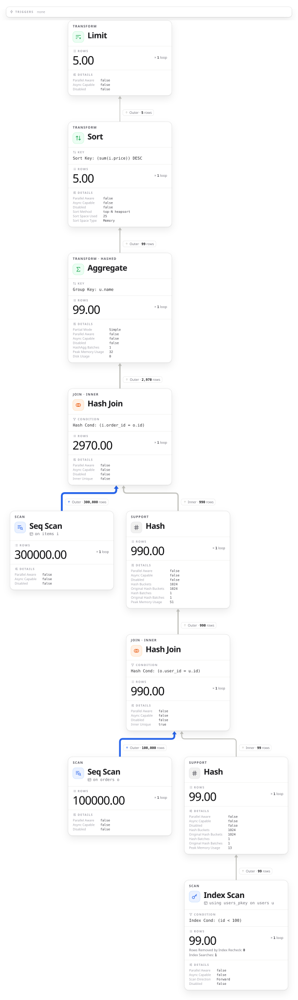
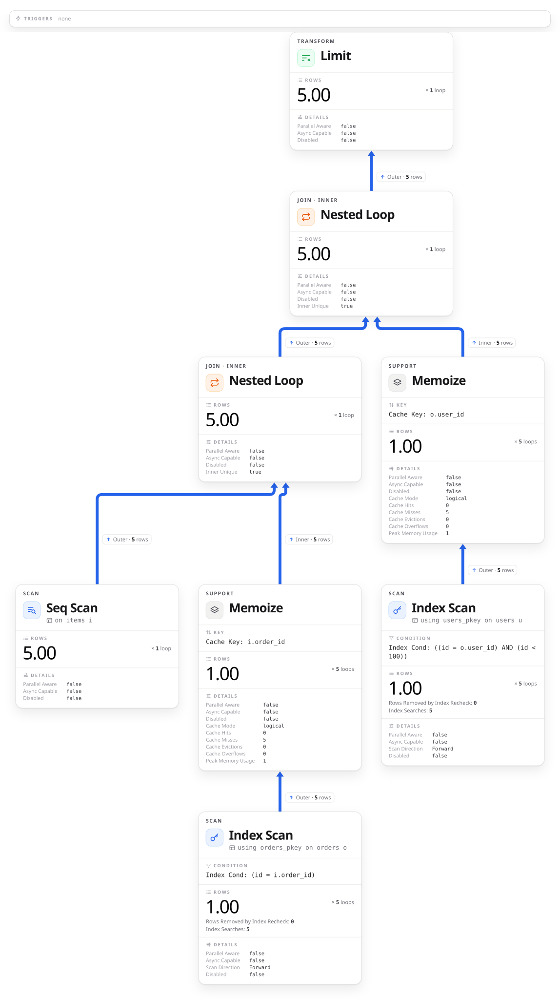

:properties:
:ID: 20261012T154743
:end:
#+title:      KDOC 658: 集計や並べ替えの後ろにある LIMIT は読む行を減らさない
#+date:       [2026-10-12 Mon 15:47]
#+filetags:   :permanent:
#+identifier: 20261012T154743

* この文書のステータス
- 作成
  - [X] 2026-10-13 貴島
- レビュー
  - [X] 2026-10-13 貴島

* 概要
:PROPERTIES:
  :header-args+: :engine postgresql
  :header-args+: :dbhost localhost
  :header-args+: :dbport 15431
  :header-args+: :results verbatim raw
  :header-args+: :wrap no
  :header-args+: :colnames no
  :header-args+: :cmdline -q
:END:

集計や並べ替えの後ろにある LIMIT は、下の処理が全部の行を読み終えるまで効かないので、読む行を減らさないのを確かめる。

ユーザー、注文、明細を結合し、ユーザーごとに金額を合計して、上位5件を取る。比べるため、集計と並べ替えを外して 5 件取る問い合わせも流す。

#+begin_src sql
  SET max_parallel_workers_per_gather = 0;
  CREATE TABLE users (id int PRIMARY KEY, name text);
  CREATE TABLE orders (id int PRIMARY KEY, user_id int);
  CREATE TABLE items (order_id int, price int);
  INSERT INTO users
  SELECT i, 'user' || i FROM generate_series(1, 10000) i;
  INSERT INTO orders
  SELECT i, i % 10000 + 1 FROM generate_series(1, 100000) i;
  INSERT INTO items
  SELECT i % 100000 + 1, i % 1000 FROM generate_series(1, 300000) i;
  ANALYZE users;
  ANALYZE orders;
  ANALYZE items;

  -- 集計して並べ替えてから 5 件取る
  EXPLAIN (ANALYZE, FORMAT JSON, COSTS OFF, TIMING OFF,
           SUMMARY OFF, BUFFERS OFF)
  SELECT u.name, sum(i.price) AS total
  FROM users u
  JOIN orders o ON o.user_id = u.id
  JOIN items i ON i.order_id = o.id
  WHERE u.id < 100
  GROUP BY u.name
  ORDER BY total DESC
  LIMIT 5;

  -- 集計も並べ替えもせずに 5 件取る
  EXPLAIN (ANALYZE, FORMAT JSON, COSTS OFF, TIMING OFF,
           SUMMARY OFF, BUFFERS OFF)
  SELECT u.name, i.price
  FROM users u
  JOIN orders o ON o.user_id = u.id
  JOIN items i ON i.order_id = o.id
  WHERE u.id < 100
  LIMIT 5;
#+end_src

#+RESULTS:

- 集計して並べ替えると、下の items の Seq Scan は 300,000 行をすべて読み、最後の Limit で 5 行に絞っている
- 集計も並べ替えもしないと、items の Seq Scan は 5 行しか読まない。Limit が 5 行を受け取った時点で、下に行を要求するのをやめている。結合のしかたも Hash Join から、1 行ずつ相手を探す Nested Loop に変わった

計画は上のノードが下のノードに 1 行ずつ要求し、行は下のノードで作られて上へ渡る。上が要求をやめれば、下も止まる。

#+begin_quote
これは本質的に要求引き寄せ型（demand-pull）パイプライン機能です。 計画ノードが呼ばれる度にもう1つの行を引き渡すか、行を引き渡したことの報告を行わなければなりません。

[[https://www.postgresql.jp/docs/18/executor.html][51.6. エグゼキュータ]]
#+end_quote

* 関連

抽象。

- 前段が全体を処理し終えないと結果が出ないとき、後ろで件数を絞っても手間は減らない

関連。

- 対比: [[id:20241109T182138][KDOC 284: パイプで結合したプロセスが終了する流れを見る]]。前段が全部を終えるのを待たない流れなら、後ろで打ち切ると前段も止まる例
- 対比: [[id:20250614T103239][KDOC 392: 絞ってから関連レコードを取得してパフォーマンスを改善する]]。件数を絞る位置が重い処理の前にあれば手間が減る、という逆の場合
- 前提: [[id:20251206T184941][KDOC 495: 文芸的にDB動作を検証できるようにする]]。文芸的に確認する道具
