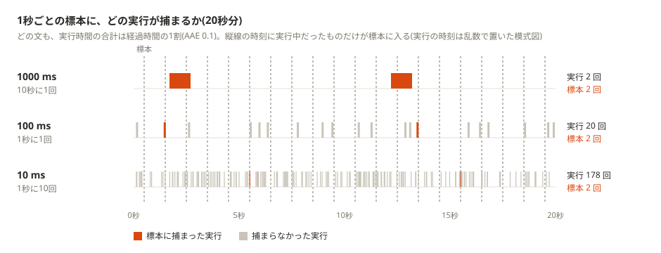

:properties:
:ID: 20261013T200358
:end:
#+title:      KDOC 659: 1秒より短いクエリも Performance Insights の負荷には実行時間どおりに出る
#+date:       [2026-10-13 Tue 20:03]
#+filetags:   :permanent:
#+identifier: 20261013T200358

* この文書のステータス
- 作成
  - [X] 2026-10-13 貴島
- レビュー
  - [X] 2026-10-13 貴島

* 概要

RDS Performance Insights は1秒間隔でサンプリングするが、1秒かからないクエリはどうなるのかと考えた。たしかに1回ずつは確率的にしか標本に出ないが、標本が多ければ負荷の大きさは実行時間どおりに出て問題ない。

Performance Insights の DB 負荷は、毎秒アクティブなセッションを数えた標本から求める(AAS)。いっぽう pg_stat_statements は、すべての呼び出しの実行時間を足している(AAE)。

#+begin_quote
Database Insights は、特定期間の総セッション数を総サンプル数で割って AAS を計算します。

(略)

AAE を計算するために、Database Insights では、クエリの合計実行時間を時間間隔で割ります。

[[https://docs.aws.amazon.com/ja_jp/AmazonRDS/latest/UserGuide/USER_PerfInsights.Overview.ActiveSessions.html][データベース負荷 - Amazon Relational Database Service]]
#+end_quote

1秒ごとに pg_stat_activity でアクティブなセッションを数える標本と、pg_stat_statements の実行時間を並べて比べる。1000 ms、100 ms、10 ms の文を、どれも実行時間の合計が経過時間の1割になる頻度で流しながら、300回標本を取る。

#+caption: 1秒ごとの標本から求めた負荷(AAS)と、実行時間から求めた負荷(AAE)を比べる
#+begin_src shell :results output drawer
  # 負荷を流す側と標本を取る側の2つのセッションが同時に要るので、pgpg のプロキシを通さず PostgreSQL に直接(15433)つなぐ
  sample() {
    psql -h localhost -p 15433 -U postgres -d postgres -qAt <<'SQL'
  CREATE TEMP TABLE samples (query_id bigint);
  -- Performance Insights と同じく、1秒ごとにアクティブなセッションを300回数える
  DO $$
  BEGIN
    FOR i IN 1..300 LOOP
      PERFORM pg_stat_clear_snapshot();
      INSERT INTO samples
      SELECT query_id FROM pg_stat_activity
      WHERE application_name = 'pgbench' AND state = 'active';
      PERFORM pg_sleep(1);
    END LOOP;
  END $$;
  -- 実行時間から求めた負荷(AAE)と、標本から求めた負荷(AAS)を並べる
  SELECT format('| %s ms | %s | %s | %s | %s |',
                round(s.mean_exec_time), s.calls, round((s.total_exec_time / 1000 / 300)::numeric, 3),
                n, round(n / 300.0, 3))
  FROM pg_stat_statements s,
       LATERAL (SELECT count(*) AS n FROM samples WHERE query_id = s.queryid) c
  WHERE s.query LIKE 'SELECT%pg_sleep%'
  ORDER BY s.mean_exec_time DESC;
  SQL
  }

  docker exec pgpg-postgres-1 psql -U postgres -qAt -c "SELECT pg_stat_statements_reset()" > /dev/null
  # pg_stat_statements は定数をまとめるので、文の形を変えて別の文として数えさせる
  printf 'SELECT pg_sleep(1);\n' | docker exec -i pgpg-postgres-1 sh -c 'cat > /tmp/s1000.sql'
  printf 'SELECT 1 FROM pg_sleep(0.1);\n' | docker exec -i pgpg-postgres-1 sh -c 'cat > /tmp/s100.sql'
  printf 'SELECT 1, 2 FROM pg_sleep(0.01);\n' | docker exec -i pgpg-postgres-1 sh -c 'cat > /tmp/s10.sql'
  # どれも実行時間の合計が経過時間の1割(AAE 0.1)になるように、1回の時間に反比例した頻度で流す
  docker exec pgpg-postgres-1 pgbench -U postgres -n -R 0.1 -T 301 -f /tmp/s1000.sql postgres > /dev/null 2>&1 &
  docker exec pgpg-postgres-1 pgbench -U postgres -n -R 1 -T 301 -f /tmp/s100.sql postgres > /dev/null 2>&1 &
  docker exec pgpg-postgres-1 pgbench -U postgres -n -R 10 -T 301 -f /tmp/s10.sql postgres > /dev/null 2>&1 &
  sleep 0.5
  echo '| 文の時間 | 呼び出し | AAE | 標本(300回中) | AAS |'
  echo '|-'
  sample
  wait
#+end_src

#+RESULTS:
:results:
| 文の時間 | 呼び出し | AAE                    | 標本(300回中) | AAS            |
|---------+---------+------------------------+--------------+----------------|
| 1001 ms |      26 | 0.087(26*1.001/300)    |           26 | 0.087 (26/300) |
| 101 ms  |     305 | 0.103(305*0.101/300)   |           31 | 0.103 (31/300) |
| 10 ms   |    3000 | 0.101(3000*0.0101/300) |           29 | 0.097 (29/300) |
:end:

- どの長さの文も、標本から求めた AAS は実行時間から求めた AAE とほぼ同じだった
- 1000 ms の文は、26回の呼び出しが26回の標本に出た。1回の呼び出しが、ほぼ1回の標本に出ている
- 100 ms の文は305回呼ばれて標本に出たのは31回、10 ms の文は3000回呼ばれて29回だった。1秒より短い文は、呼び出しのうち「文の時間 / 1秒」くらいの割合しか標本に出ない
- 1秒より短い文は、1回ずつは確率的にしか標本に出ないが、数が集まれば負荷の大きさは実行時間どおりに出る

#+caption: 1秒ごとの標本に捕まる実行の模式図。短い文ほど1回ずつは捕まりにくいが、回数が多いので、捕まる数は同じくらいになる

* 関連

抽象。

- 間隔の粗い標本でも、数が多ければ短い出来事の総量を正しく見積もれる

関連。

- 前提: [[id:20260915T211035][KDOC 617: Cloudwatch の dbLoad は負荷ではない]]。Performance Insights の DB 負荷がアクティブセッション数であること
- 対比: [[id:20260930T084643][KDOC 641: 大きなテーブルだとANALYZEで生成される統計情報はテーブルのランダムな標本から取り出される]]。標本から見積もる点は同じだが、取り直すたびに見積もりが揺れる面を見ている例
- 前提: [[id:20261009T231020][KDOC 650: Performance Insights の SQL 統計は pg_stat_statements を集計している]]
