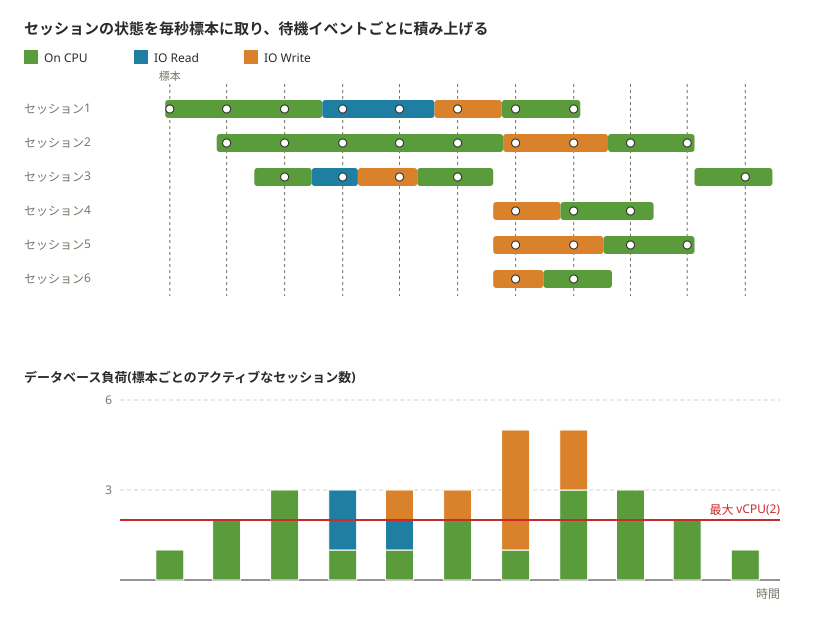

:properties:
:ID: 20261013T200753
:end:
#+title:      KDOC 660: Performance Insights で vCPU が重要な理由
#+date:       [2026-10-13 Tue 20:07]
#+filetags:   :permanent:
#+identifier: 20261013T200753

* この文書のステータス
- 作成
  - [X] 2026-10-13 貴島
- レビュー
  - [X] 2026-10-13 貴島

* 概要

RDS Performance Insights ではvCPUが重要な指標というが、なぜ重要なのかを理解していなかった。

[[https://pages.awscloud.com/rs/112-TZM-766/images/B3-04.pdf][Amazon RDSにおけるパフォーマンス最適化とパフォーマンス管理]]の図がわかりやすい。

#+caption: セッションの状態を毎秒標本に取り、待機イベントごとに積み上げる。[[https://pages.awscloud.com/rs/112-TZM-766/images/B3-04.pdf][Amazon RDSにおけるパフォーマンス最適化とパフォーマンス管理]]の19ページの図を描き直し、vCPU が 2 のときの最大 vCPU の線を足した

vCPU は一度に1つのプロセスしか動かせないので、CPU で動きたいセッションが vCPU の数を超えると、CPU の順番待ちが起きる。DB 負荷が vCPU の線を超え、その大半が CPU が必要なセッションだとCPU不足となる。

図では、3本目・8本目・9本目の標本が CPU だけで線を超えていて、CPU の順番待ちが起きている。7本目の標本は合計 5 で線を大きく超えるが、CPU が 1 で残りが IO Write なので、CPU 不足ではない。CPU を増やしても速くならず、書き込みの待ちを減らす必要がある。

#+begin_quote
vCPU では一度に 1 つのプロセスを実行できます。プロセスの数が vCPU の数を超えると、プロセスはキューイングを開始します。キューイングが増加すると、データベースのパフォーマンスが低下します。DB 負荷が [Max vCPU (最大 vCPU)] ラインをしばしば超過し、プライマリ待機状態が CPU である場合、CPU が過負荷になっています。

[[https://docs.aws.amazon.com/ja_jp/AmazonRDS/latest/UserGuide/USER_PerfInsights.Overview.MaxCPU.html][最大 CPU 容量 - Amazon Relational Database Service]]
#+end_quote

* 関連

- 前提: [[id:20261013T211643][KDOC 661: AASとAAEを理解する]]。DB 負荷の単位 AAS は同時に動いているセッション数の平均なので、vCPU の数と同じ単位で比べられる
